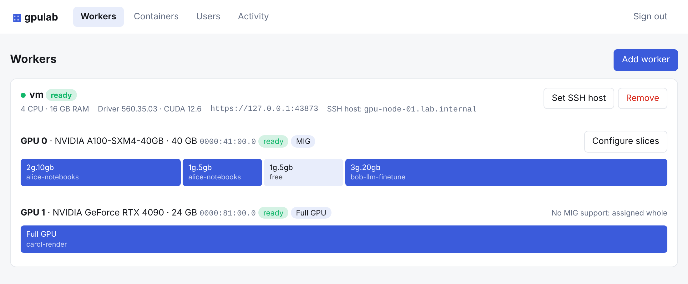
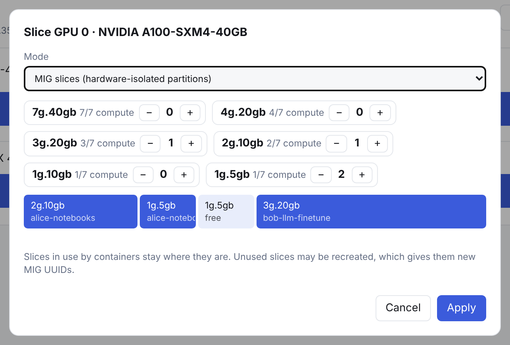
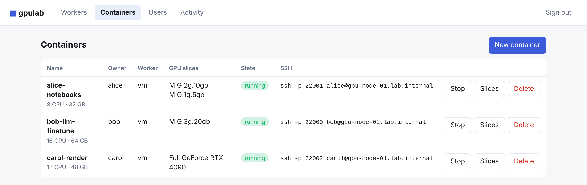
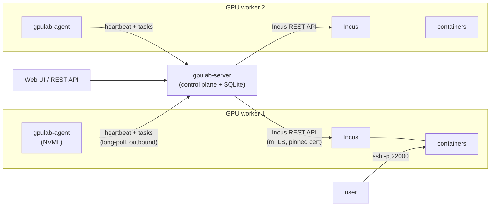
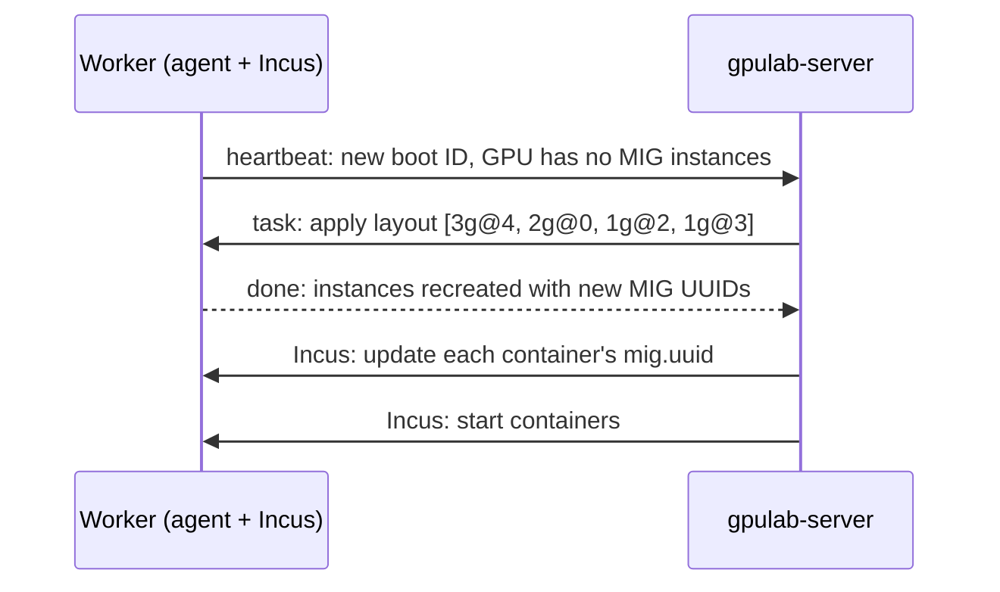

<div align="center">

# ▦ gpulab

**Self-hosted GPU slicing for teams and labs.**<br>
Pool your NVIDIA GPU servers, slice them with MIG, and give everyone an SSH-ready container. All from one web UI.

[](https://github.com/muneeb-ds/gpulab/actions/workflows/ci.yml)
[](go.mod)
[](LICENSE)


[Quick start](#-quick-start) · [Features](#-features) · [How it works](#-how-it-works) · [Install](#-installation) · [FAQ](#-faq) · [Roadmap](#-roadmap)



</div>

> [!WARNING]
> **gpulab is alpha software.** It is fully tested against simulated GPUs and a simulated Incus API, but it has
> **not yet been run on real NVIDIA hardware**. Expect rough edges on the first real deployment, and please
> [open an issue](https://github.com/muneeb-ds/gpulab/issues) with what you find.

## Why gpulab?

An 80 GB H100 is far more than one notebook needs. NVIDIA's **Multi-Instance GPU (MIG)** can split it into up to
seven hardware-isolated GPUs. Doing that by hand across several servers gets painful quickly:

- `nvidia-smi mig` commands with placement rules that are easy to get wrong
- MIG device UUIDs that **change every time a slice is recreated**, including after every reboot
- keeping track of which slice belongs to whom, on which host
- attaching the right slice to the right container, plus users, SSH keys and ports

gpulab does that bookkeeping. You add workers, pick a layout, and hand out containers. Users get an SSH command.

## ✨ Features

- **Multi-worker pool.** Join any number of GPU servers with a one-line install command; approve them in the UI.
- **Visual MIG slicing.** Choose profiles (`1g.10gb`, `3g.40gb`, …), and gpulab only offers layouts that physically fit,
  using the GPU's real placement rules.
- **Changes don't disturb running work.** Re-slicing a GPU only touches slices that change. Slices in use are never removed.
- **Whole-GPU mode.** GPUs without MIG support (or that you'd rather not split) are assigned whole.
- **SSH-ready Incus containers.** Each container gets a Linux user, SSH keys, CPU and memory limits, the NVIDIA runtime,
  and its own SSH port.
- **Several slices per container.** Run several jobs side by side, each on its own isolated slice.
- **Survives reboots.** When a worker restarts, gpulab recreates its MIG layout, updates every container with the new
  slice UUIDs, and starts them again, with no manual steps.
- **One binary, no dependencies.** The control plane is a single Go binary with an embedded UI and SQLite.
- **Secure by default.** Workers join with single-use tokens, and the control plane talks to Incus over mutual TLS with
  the server certificate pinned.

<table>
<tr>
<td width="50%"></td>
<td width="50%"></td>
</tr>
<tr>
<td align="center"><sub>Pick MIG profiles and preview where they'll go</sub></td>
<td align="center"><sub>Containers, their slices, and how to SSH in</sub></td>
</tr>
</table>

## 🚀 Quick start

Try the full UI on your laptop, with **no GPU needed**. `--demo` starts a simulated worker with an A100-40GB and an
RTX 4090 behind a fake Incus API:

```bash
git clone https://github.com/muneeb-ds/gpulab && cd gpulab
make demo
```

Open **http://localhost:8080**, sign in with `demo`, then:

1. **Workers** → **Approve** the simulated worker
2. **Configure slices** on the A100 → e.g. `3g.20gb` + `2g.10gb` + 2 × `1g.5gb` → **Apply**
3. **Users** → add a user with an SSH public key
4. **Containers** → **New container** → pick one or more slices → **Create**

Demo state lives in memory and is discarded on exit. Requires Go 1.24+ and a C compiler (for the NVML bindings).

## 🧭 How it works



| Component | Job |
|---|---|
| **gpulab-server** | Keeps the desired state (GPU layouts, containers, users). Runs operations one at a time per worker, and reconciles with Incus every 15 s. |
| **gpulab-agent** | Runs on each worker. Reports GPUs, MIG profiles and placements through NVML, creates and removes MIG instances at exact placements, and trusts the control plane in Incus. Connects outbound only. |
| **Incus** | Runs the system containers. gpulab attaches slices as `gputype=mig` + `mig.uuid` devices, or `gputype=physical` for whole GPUs. |

### What happens when a worker reboots

MIG instances don't survive a reboot, and when they are recreated they come back with **new UUIDs**. gpulab
identifies a slice by *(GPU, profile, placement)*, not by UUID, so it can recover on its own:



Containers are created with `boot.autostart=false`, so Incus never starts them with stale GPU devices.

## 📦 Installation

### 1. Control plane

Any Linux machine that the workers and your browser can reach:

```bash
make build
sudo install bin/gpulab-server bin/gpulab-agent /usr/local/bin/
echo "GPULAB_ADMIN_TOKEN=$(openssl rand -hex 24)" | sudo tee /etc/default/gpulab-server
sudo chmod 600 /etc/default/gpulab-server
```

Edit the public URL and TLS paths in [`deploy/gpulab-server.service`](deploy/gpulab-server.service), then:

```bash
sudo cp deploy/gpulab-server.service /etc/systemd/system/
sudo systemctl enable --now gpulab-server
```

> [!IMPORTANT]
> Serve the control plane over TLS (`--tls-cert`/`--tls-key`, or behind a reverse proxy). Agents send their secret on every heartbeat.

### 2. GPU workers

Prerequisites on each worker:

- NVIDIA driver (R470 or newer, needed for Incus's `mig.uuid` device option)
- [`nvidia-container-toolkit`](https://docs.nvidia.com/datacenter/cloud-native/container-toolkit/latest/install-guide.html)
- [Incus](https://linuxcontainers.org/incus/docs/main/installing/), initialised with `incus admin init`
  (with a default profile that has a root disk and a network)
- Port **8443** reachable from the control plane, and ports **22000–22999** reachable by your users

In the UI, click **Add worker** and run the command it shows on the worker:

```bash
curl -fsSL https://gpulab.example.com/install-agent.sh | sudo bash -s -- \
  --server https://gpulab.example.com --join-token <token>
```

The script checks the prerequisites and exposes the Incus API on `:8443` if it isn't already. It then installs
`gpulab-agent` as a systemd service. Approve the worker in the UI and it's ready.

## ⚙️ Configuration

<details>
<summary><b>gpulab-server</b></summary>

| Flag | Default | Description |
|---|---|---|
| `GPULAB_ADMIN_TOKEN` (env) | (required) | Token for the UI and API |
| `--listen` | `:8080` | Listen address |
| `--data-dir` | `./gpulab-data` | SQLite database and the control plane's client certificate |
| `--public-url` | `http://localhost:8080` | URL agents and browsers use to reach the server |
| `--tls-cert`, `--tls-key` | | Serve HTTPS |
| `--agent-binary` | | `gpulab-agent` binary served at `/download/gpulab-agent` for the install script |
| `--image` | `ubuntu/24.04/cloud` | Default container image (must include cloud-init) |
| `--demo` | `false` | Run a simulated worker in-process (throwaway data dir) |

</details>

<details>
<summary><b>gpulab-agent</b></summary>

| Flag | Default | Description |
|---|---|---|
| `--server` / `GPULAB_SERVER` | (required) | Control plane URL |
| `--join-token` / `GPULAB_JOIN_TOKEN` | | Single-use token, only needed for the first start |
| `--state-dir` | `/var/lib/gpulab-agent` | Where the agent stores its credentials |
| `--incus-socket` | `/var/lib/incus/unix.socket` | Local Incus socket |
| `--incus-url` | `https://<detected IP>:8443` | Address the control plane uses to reach this worker's Incus API |

</details>

### Supported GPUs

| GPU | Support |
|---|---|
| A100 40 GB / 80 GB, H100 80 GB, A30 | MIG slicing. Built-in profile catalog, so layouts can be planned before MIG is enabled |
| Other MIG-capable GPUs | MIG slicing using the profiles NVML reports once MIG mode is on |
| All other NVIDIA GPUs | Whole-GPU assignment |

## 🔌 API

Everything in the UI goes through a JSON API authenticated with the admin token:

```bash
curl -H "Authorization: Bearer $GPULAB_ADMIN_TOKEN" https://gpulab.example.com/api/overview
```

<details>
<summary>Endpoints</summary>

| Method | Path | Purpose |
|---|---|---|
| `GET` | `/api/overview` | Workers, GPUs, slices, containers, users |
| `POST` | `/api/join-tokens` | Create a worker join token and install command |
| `POST` | `/api/nodes/{id}/approve` | Approve a worker |
| `PATCH` | `/api/nodes/{id}` | Set `ssh_host` or `status` (`ready`/`disabled`) |
| `DELETE` | `/api/nodes/{id}` | Remove a worker (must have no containers) |
| `POST` | `/api/gpus/{id}/validate` | Check a layout: `{"mode":"mig","profiles":["3g.40gb","1g.10gb"]}` |
| `POST` | `/api/gpus/{id}/layout` | Apply a layout (`mode`: `mig` or `exclusive`) |
| `POST` | `/api/users` | Create a user: `{"name":"alice","ssh_keys":"ssh-ed25519 …"}` |
| `DELETE` | `/api/users/{id}` | Delete a user (must own no containers) |
| `POST` | `/api/containers` | Create: `{"name":"alice-box","user_id":1,"slice_ids":[3,4],"cpu":8,"memory_mb":32768}` |
| `POST` | `/api/containers/{id}/start` · `/stop` | Power |
| `PUT` | `/api/containers/{id}/slices` | Replace a container's slices (restarts it) |
| `DELETE` | `/api/containers/{id}` | Delete a container |
| `GET` | `/api/operations` | Recent operations and their errors |

</details>

## ❓ FAQ

<details>
<summary><b>Can one process use several MIG slices as one bigger GPU?</b></summary>

No. That's a MIG limitation, not a gpulab one. A CUDA process sees a single MIG instance. Several slices in one
container let you run several processes side by side. For one bigger job, choose a bigger profile.
</details>

<details>
<summary><b>Why does a container restart when I change its slices?</b></summary>

Incus can't hot-plug MIG devices, so gpulab stops the container, swaps its GPU devices, and starts it again.
</details>

<details>
<summary><b>Why Incus and not Kubernetes?</b></summary>

gpulab is for people who want a persistent Linux machine they can SSH into, such as researchers, students and
developers, not a pod scheduler. Incus system containers behave like lightweight VMs, start in seconds and need
no cluster to run. If you need batch scheduling on Kubernetes, look at the NVIDIA GPU Operator.
</details>

<details>
<summary><b>Do I need to enable MIG mode by hand?</b></summary>

No. gpulab enables it when you apply a MIG layout. On some GPUs the change only takes effect after a GPU reset or
reboot. gpulab tells you when that's needed and doesn't reset the GPU itself.
</details>

<details>
<summary><b>Does it work with Incus clusters?</b></summary>

Each worker is registered as a standalone Incus server, which keeps workers independent: no cluster quorum to
maintain, and workers can come and go. Clustered Incus support is on the roadmap.
</details>

## 🗺 Roadmap

- [x] Multi-worker pool with token-based join
- [x] MIG slicing with placement-aware validation
- [x] Whole-GPU assignment for non-MIG GPUs
- [x] SSH-ready containers with per-user keys
- [x] Automatic recovery after worker reboots
- [ ] Validation on real A100 / H100 hardware
- [ ] Per-user logins with self-service containers
- [ ] Quotas, reservations and expiry
- [ ] Single SSH gateway (one port for all containers)
- [ ] GPU sharing without MIG (time-slicing / MPS)
- [ ] VM support with vGPU / SR-IOV
- [ ] GPU utilisation metrics (DCGM)

## 🛠 Development

```bash
make test    # go vet, unit tests, and an end-to-end test under the race detector
make build   # bin/gpulab-server and bin/gpulab-agent
```

The end-to-end test in [`internal/e2e`](internal/e2e) runs the real control plane and the real agent against
simulated GPUs and a simulated Incus API. It covers joining, approval, slicing, containers, the safety checks,
a worker reboot, and swapping slices.

<details>
<summary>Project layout</summary>

| Path | What |
|---|---|
| `cmd/gpulab-server`, `cmd/gpulab-agent` | Binaries |
| `internal/server` | API, agent endpoint, operation runner, reconciler |
| `internal/store` | SQLite schema and queries |
| `internal/mig` | Layout solver and built-in MIG profile catalogs |
| `internal/agent`, `internal/agent/gpu` | Agent loop; NVML and simulated GPU backends |
| `internal/incus` | Minimal Incus REST client; `fakeincus` test server |
| `internal/e2e` | End-to-end test |
| `web/` | Embedded UI and the agent install script |

</details>

## 🤝 Contributing

Bug reports, especially from real hardware, are very welcome: [open an issue](https://github.com/muneeb-ds/gpulab/issues).
For anything larger than a small fix, please open an issue to discuss it before sending a pull request. Because gpulab
is also offered under commercial licenses, contributors will be asked to sign a contributor license agreement.

## 📄 License

gpulab is source-available under the [PolyForm Noncommercial License 1.0.0](LICENSE). You may use, modify and
share it for any **noncommercial** purpose, including personal use, research, education, and use by charities and
public institutions.

**Commercial use requires a separate license.** To ask for one, [open an issue](https://github.com/muneeb-ds/gpulab/issues).
